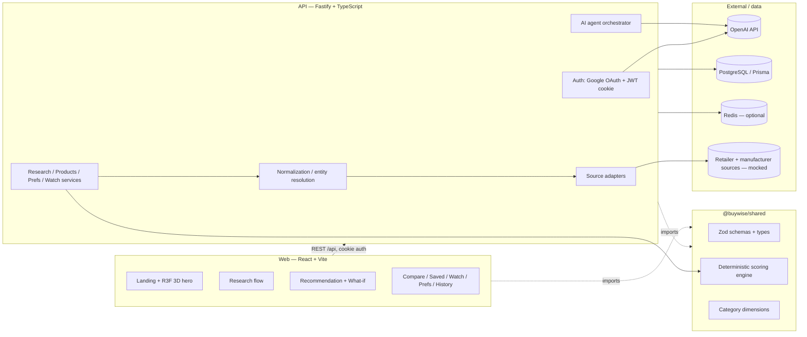
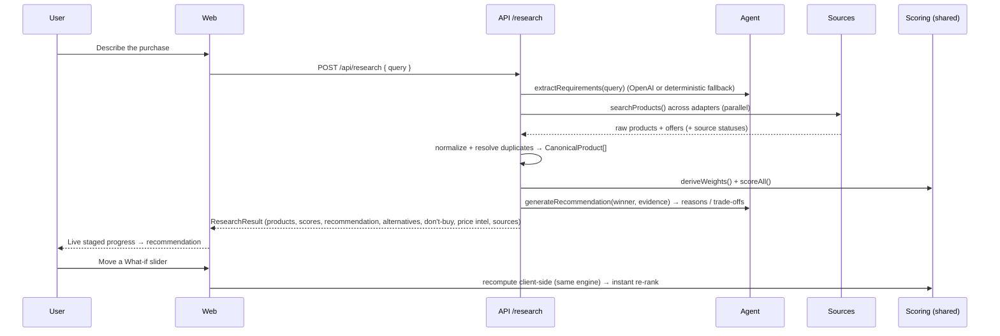
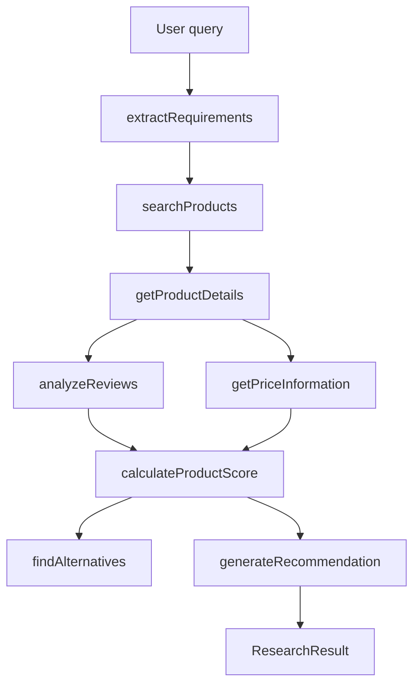
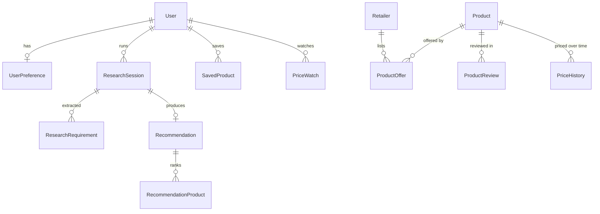

# BuyWise

> **Research less. Buy smarter.**
> An AI shopping *decision* agent — not a search box. You describe what you want in plain language; BuyWise researches multiple sources, normalizes the data, scores every candidate against *your* priorities with a deterministic engine, and explains the recommendation, the trade-offs, and what **not** to buy.

<p align="center"><em>Intent → Research → Compare → Decide</em></p>

---

## Table of contents

- [What it does](#what-it-does)
- [Screenshots](#screenshots)
- [Architecture](#architecture)
- [The AI agent & tool architecture](#the-ai-agent--tool-architecture)
- [The deterministic scoring engine](#the-deterministic-scoring-engine)
- [Multi-source adapter architecture](#multi-source-adapter-architecture)
- [Database schema](#database-schema)
- [Tech stack](#tech-stack)
- [Local development](#local-development)
- [Environment variables](#environment-variables)
- [Google OAuth setup](#google-oauth-setup)
- [OpenAI setup](#openai-setup)
- [Database setup](#database-setup)
- [Deployment](#deployment)
- [What's functional vs mocked](#whats-functional-vs-mocked)
- [Security](#security-considerations)
- [Design decisions](#design-decisions)
- [Roadmap](#roadmap)
- [Interview notes](#interview-notes)

---

## What it does

A user writes, for example:

> *“I need a laptop under ₹1.2L for Java development, Docker, Kubernetes, occasional AI experimentation and gaming. I travel frequently, so weight and battery matter.”*

BuyWise then:

1. **Extracts structured requirements** — budget, use-cases, hard constraints, and *priorities* (what actually matters to this user).
2. **Researches multiple sources** — retailers + manufacturer specs + reviews, through a pluggable adapter layer.
3. **Normalizes & de-duplicates** — resolves the *same* product across sources into one canonical entity.
4. **Scores deterministically** — a transparent engine weights each candidate against the user's priorities. The LLM never invents the number.
5. **Explains the decision** — why this wins, the honest trade-offs, labelled alternatives (best value / performance / battery / cheapest), and a prominent **“wouldn't recommend”** section with reasons.
6. **Price intelligence** — 30-day average, 90-day low, trend, buy/wait call — *only* where real history exists, otherwise it says *“insufficient historical data.”*
7. **“What-if” mode** — nudge the budget or shift priorities and the ranking recomputes **instantly** (client-side, using the exact same scoring code as the server).

### Core principles

- **Never fabricate** prices, reviews, availability, specs, or historical pricing. If data is missing, say so.
- **Reasoning vs. computation are separated.** The LLM orchestrates and writes prose; deterministic services own scoring, filtering, validation and permissions.
- **No chain-of-thought is ever exposed** — only concise action/status summaries and evidence.
- **It's a decision tool, not a chat window.**

---

## Screenshots

> _Add captures of the landing hero, the live research flow, and a recommendation page here._

| Landing + 3D decision engine | Live research | Recommendation + what-if |
| --- | --- | --- |
| `docs/landing.png` | `docs/research.png` | `docs/result.png` |

---

## Architecture

A TypeScript monorepo (npm workspaces) with a shared contracts package consumed by **both** the API and the web client — so the data model and the scoring math can never drift.



**Request flow for a research run:**



### Monorepo layout

```
BuyWise/
├─ packages/shared/      # Zod schemas, domain types, category dimensions,
│                        # and the deterministic scoring engine (used by BOTH apps)
├─ apps/api/             # Fastify API: agent, sources, services, auth, routes, Prisma
└─ apps/web/             # React + Vite client: landing, 3D hero, app shell, screens
```

---

## The AI agent & tool architecture

The agent is an **orchestrator**, not a monolithic prompt. It decides which tools to call and uses structured I/O; the tools return real data from deterministic services.



| Tool | Responsibility | Owned by |
| --- | --- | --- |
| `extractRequirements` | NL → structured budget / use-cases / priorities / constraints | LLM (fallback: deterministic parser) |
| `searchProducts` | Query every enabled source adapter | Services |
| `getProductDetails` | Canonical, normalized product record | Services |
| `analyzeReviews` | Aggregate sentiment, pros/cons | Services |
| `getPriceInformation` | Current + historical price intelligence | Services |
| `calculateProductScore` | Weighted score per priorities | **Shared engine (deterministic)** |
| `findAlternatives` | Best value / performance / battery / cheapest | **Shared engine** |
| `generateRecommendation` | Prose: why it wins, trade-offs, evidence | LLM (fallback: templated-from-data) |

- **Model is env-configurable** (`OPENAI_MODEL`), uses structured outputs + Zod validation + retries.
- **Graceful degradation:** with **no API key**, a fully deterministic fallback produces a complete, grounded result — so the demo works offline. Prose is templated from the product's real attributes/specs, never invented.

---

## The deterministic scoring engine

Lives in `packages/shared/src/scoring.ts` and runs identically on server and client.

- Each category defines scoring **dimensions** with neutral default weights (e.g. laptops: performance, value, battery, portability, display, gaming, reviews).
- Each product carries normalized `attributes` (0–100) per dimension, derived from specs + reviews during normalization.
- `deriveWeights()` tilts the defaults by the user's stated priorities, with a gentle **tension model** (prioritizing battery slightly damps raw-performance weight, etc.).
- `scoreProduct()` = Σ(weight × attribute), with a budget-overage penalty.
- `pickAlternatives()` and `deriveDontBuy()` are rule-based and explainable.

Because the client imports the same module, **What-if** recomputes instantly with zero risk of disagreeing with the server.

---

## Multi-source adapter architecture

Sources implement one interface and are swapped freely — the agent is **never** coupled to a specific website.

```ts
interface ProductSource {
  id: string; name: string; isOfferSource: boolean;
  searchProducts(req: Requirements): Promise<RawProduct[]>;
  getProductDetails(externalId: string): Promise<RawProduct | null>;
  getOffers(externalId: string): Promise<RawOffer[]>;
}
```

Shipped adapters (all **mocked**, reading a richly-seeded catalog with per-retailer price variation): `AmazonAdapter`, `FlipkartAdapter`, `CromaAdapter`, `RelianceDigitalAdapter`, `ManufacturerAdapter` (authoritative specs, no offers). Each file marks `// TODO(real-integration)` exactly where a live API/scrape plugs in. Normalization resolves duplicates by a stable `modelKey` with a fuzzy token-overlap fallback.

---

## Database schema

Postgres via Prisma. UUID keys, `createdAt`/`updatedAt`, indexed foreign keys. **Optional** — with no `DATABASE_URL` the API runs fully in-memory (demo mode).



Core tables: `users`, `user_preferences`, `products`, `product_offers`, `retailers`, `product_reviews`, `research_sessions`, `research_requirements`, `recommendations`, `recommendation_products`, `price_history`, `saved_products`, `price_watches`.

---

## Tech stack

**Frontend:** React 18, TypeScript, Vite, React Three Fiber + drei + three, Material UI (hard-themed), Framer Motion, React Router, TanStack Query, Zustand, React Hook Form, Zod, Lucide icons.

**Backend:** Node + TypeScript, Fastify, Prisma + PostgreSQL, Redis (optional), OpenAI SDK, Pino, Zod.

**Shared:** `@buywise/shared` — Zod contracts + the scoring engine.

---

## Local development

**Prerequisites:** Node ≥ 20, npm ≥ 9.

```bash
# from the repo root
npm install                 # installs all workspaces
cp .env.example apps/api/.env   # fill in values (or leave blank for demo mode)
cp .env.example apps/web/.env   # only VITE_* vars are used by the web app

npm run build:shared        # build the shared contracts once
npm run dev                 # runs API (:4000) + web (:5173) together
```

Open http://localhost:5173 → **Continue in demo mode** → run a research.

> The repo ships with a project `.npmrc` (`legacy-peer-deps=true`) because `@react-three/drei` declares `expo`/`react-native` as optional peers that otherwise bloat resolution. This is safe — the project is web/node only.

**Useful scripts:** `npm run dev:api`, `npm run dev:web`, `npm run build`, `npm run typecheck`, `npm run db:push`, `npm run db:seed`.

---

## Environment variables

All configured via env; **no secrets ever reach the browser** (only `VITE_*` is exposed). See [`.env.example`](./.env.example).

| Variable | Where | Required | Notes |
| --- | --- | --- | --- |
| `OPENAI_API_KEY` | API | No* | Omit → deterministic fallback agent. *Required for live LLM reasoning. |
| `OPENAI_MODEL` | API | No | Defaults to a current reasoning-capable model. |
| `DATABASE_URL` | API | No | Omit → in-memory demo mode. |
| `REDIS_URL` | API | No | Omit → in-memory cache + limiter. |
| `GOOGLE_CLIENT_ID` / `GOOGLE_CLIENT_SECRET` | API | No | Omit → demo login still works. |
| `SESSION_SECRET` | API | Yes | Long random string for JWT signing. |
| `FRONTEND_URL` / `BACKEND_URL` | API | Yes | For CORS + OAuth callback. |
| `VITE_API_URL` | Web | Yes | API origin. |
| `VITE_ENABLE_3D` | Web | No | `false` to force the static hero. |

---

## Google OAuth setup

1. [Google Cloud Console](https://console.cloud.google.com/) → create a project.
2. **APIs & Services → OAuth consent screen** → External → add your email as a test user.
3. **Credentials → Create credentials → OAuth client ID → Web application**.
4. **Authorized redirect URI:** `http://localhost:4000/api/auth/google/callback` (and your deployed `BACKEND_URL` equivalent).
5. Copy the client ID/secret into `apps/api/.env`.

Without these, the **demo login** button issues a session so you can use the full app locally.

## OpenAI setup

1. Create a key at [platform.openai.com/api-keys](https://platform.openai.com/api-keys).
2. Put it in `apps/api/.env` as `OPENAI_API_KEY` (server-side only — never in the web app).
3. Optionally set `OPENAI_MODEL`.

Without a key, BuyWise uses its deterministic fallback agent end-to-end.

## Database setup

1. Create a free Postgres on [Neon](https://neon.tech) or [Supabase](https://supabase.com).
2. Set `DATABASE_URL` in `apps/api/.env`.
3. `npm run db:push` then `npm run db:seed`.

Skip all of this to run in demo mode.

---

## Deployment

- **Frontend → Netlify.** Build `npm run build --workspace @buywise/web`, publish `apps/web/dist`, set `VITE_API_URL`. SPA redirect: `/* → /index.html 200`.
- **Backend → Render / Railway / Fly.io.** Build `npm run build`, start `npm run start --workspace @buywise/api`, set all API env vars.
- **Database → Neon / Supabase** free tier.

> If a provider's free tier has changed, any equivalent (e.g. Vercel for the SPA, Koyeb for the API) works — everything is env-configurable.

---

## What's functional vs mocked

**Fully functional**
- End-to-end research → recommendation on seeded data (works with **no** API key / DB).
- Deterministic scoring, alternatives, don't-buy, and **instant client-side what-if**.
- Product normalization / entity resolution across sources.
- Compare (2–5), preferences, saved, price-watch, history (in-memory or DB-backed).
- Google OAuth + JWT-cookie sessions + demo login; protected routes; rate limiting; sanitized errors.
- Price intelligence from seeded history — with honest *“insufficient data”* when absent.

**Mocked / stubbed (clearly marked in code)**
- Retailer + manufacturer sources are mock adapters over a seeded catalog (`// TODO(real-integration)`).
- Price-watch background monitoring: model + UI exist; no scheduled worker runs on free hosting.
- When `OPENAI_API_KEY` is unset, prose comes from the deterministic fallback.

---

## Security considerations

- **API keys are server-side only.** The web app only ever sees `VITE_*`.
- **Sessions:** signed JWT in an `httpOnly`, `SameSite=Lax`, `Secure`-in-prod cookie.
- **Input validation** with Zod on every route; **error sanitization** (no stacks/secrets to clients; full logs server-side).
- **Rate limiting** globally and stricter on `/research`. **CORS** locked to `FRONTEND_URL` with credentials.
- **Authorization** enforced per-route (`requireAuth`), per-user data isolation.
- Observability events (`research_started`, `tool_called`, …) logged without sensitive PII.

---

## Design decisions

- **Decision-first UX, not a chatbot.** The interface is `Intent → Research → Compare → Decide`.
- **Separation of reasoning and computation.** LLMs are great at language and orchestration, unreliable at arithmetic — so scoring is pure, tested, deterministic code shared by client and server.
- **Honesty over polish.** Missing price history shows *“insufficient data”*; sources that weren't queried are never claimed.
- **Custom, restrained visual identity.** Warm neutral foundation + a single jade accent, Inter with tabular numerics, intentional motion. No generic AI-gradient/robot/sparkle aesthetic.
- **Performance-aware 3D.** The R3F hero degrades (fewer elements, no shadows, lower DPR) on constrained viewports and disables entirely under `prefers-reduced-motion` or without WebGL, with an elegant static fallback.

---

## Roadmap

- Real retailer integrations behind the existing `ProductSource` interface.
- Scheduled price-watch worker (cron/queue) + email/push alerts.
- Streaming research progress via SSE.
- Richer entity resolution (embedding-based matching).
- Shareable recommendation links; richer review mining.

---

## Interview notes

A concise way to talk about this project:

> *BuyWise is an AI **decision** platform, deliberately not a chat wrapper. The hard design choice is the split between reasoning and computation: the LLM extracts requirements and writes explanations, but a deterministic, unit-testable scoring engine — shared verbatim between the Node API and the React client — produces every number. That shared package is why “what-if” can recompute instantly in the browser and still match the server exactly. The source layer is an adapter interface with mock implementations over a seeded catalog, so swapping in a real retailer API is a one-file change and the agent never knows the difference. The whole thing runs end-to-end with no API key and no database (deterministic fallback + in-memory stores), which keeps the demo bulletproof, while Prisma/Postgres, Redis, OpenAI and Google OAuth all light up purely through environment variables. Throughout, the product refuses to fabricate data — it would rather show “insufficient history” than invent a price chart.*

---

*BuyWise is a portfolio project. Demo data is seeded and clearly labelled.*
